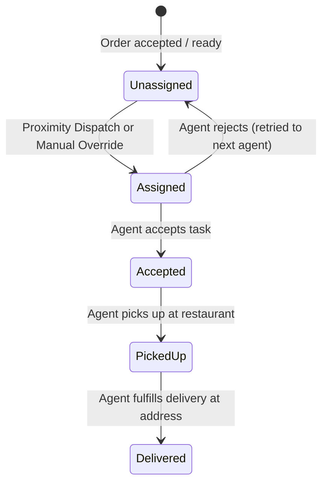

# QuickBite `order-service` — Deliveries Domain Business Logic

## 1. Delivery Lifecycle & Assignment

Delivery manages the fulfillment of orders from branch pickup to customer doorstep.

---

## 2. Assignment Modes

### 2.1 Automatic Proximity Assignment (Default)
When an order reaches `ready_for_pickup` (or `accepted` depending on branch prep time):
1. The dispatch service retrieves the branch geolocation coordinates (`lat`, `lng`).
2. Redis geospatial query `GEOSEARCH geo:agents:<region> FROMLONLAT <lng> <lat> BYRADIUS 5 km ASC COUNT 5` is executed.
3. Candidate agents are filtered for active availability (`is_available = true` and no currently active delivery).
4. If a valid agent is found:
   - Order updated with `delivery_agent_id = candidate.id`, `assigned_at = NOW()`.
   - WebSocket event `delivery:assigned` sent to `agent:<agentId>`.
   - Redis agent status set to `busy`.
5. If no agents are in proximity or candidate rejects, the task is queued for periodic retry.

### 2.2 Manual Restaurant Override
- A restaurant owner or manager with `orders:delivery:manual_assign` permission may explicitly assign or reassign an order to a designated delivery agent.
- Concurrency guard: Updates are guarded with transactional check ensuring the order is not already in transit (`out_for_delivery` or `delivered`).

---

## 3. Delivery Agent Actions & Constraints

### 3.1 Task Acceptance & Rejection
- When assigned, the agent has a 60-second window to accept or reject.
- **Accept**: Sets `status = 'accepted'` (or keeps order progressing towards pickup), marks agent as locked to this delivery.
- **Reject**: Clears `delivery_agent_id`, sets `assigned_at = NULL`, and dispatches the task to the next available agent. Maximum 3 rejections before escalating to restaurant/admin alert.

### 3.2 Pickup (`PATCH /api/deliveries/:orderId/pickup`)
- Agent arrives at branch, verifies order items, and marks order picked up.
- Order transitions to `out_for_delivery`, `picked_at = NOW()`.
- Real-time WebSocket event `order:out_for_delivery` emitted to customer.

### 3.3 Fulfillment & Settlement (`PATCH /api/deliveries/:orderId/delivered`)
- Agent delivers order to customer.
- Order transitions to `delivered`, `delivered_at = NOW()`.
- Agent marked `is_available = true` in presence store.
- **Atomic Settlement Transaction**:
  1. If COD: marks payment transaction as `completed`.
  2. Inserts agent earnings row into `agent_earnings`.
  3. Calculates restaurant payout credit (order subtotal minus platform commission) and credits `restaurant_balances`.
  4. Emits `order:delivered` WebSocket event to customer and restaurant.
