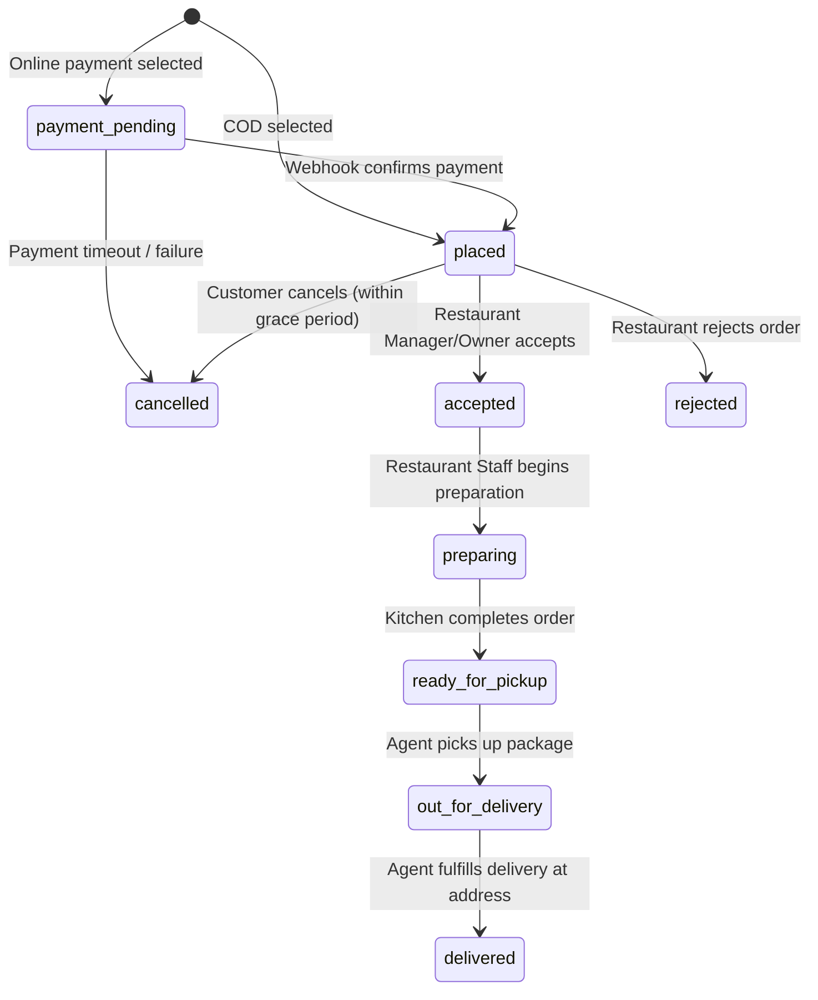

# QuickBite `order-service` — Orders Domain Business Logic

## 1. Order Lifecycle & State Machine

Every order moves through a strictly validated, unidirectional finite state machine. Transitions are enforced in `OrderService` before updating the database.



### 1.1 Legal State Transitions & Authorization Matrix

| From State | To State | Permitted Actor | Business Conditions / Constraints |
| --- | --- | --- | --- |
| *(new)* | `payment_pending` | Customer | Order initiated with `online` payment method |
| *(new)* | `placed` | Customer | Order initiated with `cod` payment method |
| `payment_pending` | `placed` | System / Webhook | Kashier v3 payment successfully verified |
| `payment_pending` | `cancelled` | System / Customer | Payment session failed or expired |
| `placed` | `accepted` | Restaurant (`accept_reject`) | Restaurant confirms kitchen capacity; sets `accepted_at` |
| `placed` | `rejected` | Restaurant (`accept_reject`) | Restaurant out of capacity; triggers refund if online |
| `placed` | `cancelled` | Customer (Owner) | Cancellation only permitted prior to restaurant acceptance |
| `accepted` | `preparing` | Restaurant Staff (`update_status`) | Kitchen preparation commences |
| `preparing` | `ready_for_pickup`| Restaurant Staff (`update_status`) | Food packed; triggers assignment notification to driver |
| `ready_for_pickup` | `out_for_delivery`| Assigned Agent / Restaurant | Agent picks up order from branch; sets `picked_at` |
| `out_for_delivery` | `delivered` | Assigned Agent | Agent marks completed at destination; sets `delivered_at`; triggers financial settlement |
| *any non-terminal*| `cancelled` | System Admin | Emergency admin override; records reason |

---

## 2. Order Creation & Placement Workflow

1. **Validation**:
   - Customer authentication & address ownership verified.
   - Idempotency-Key validated (Redis check & DB lock).
   - Branch status checked via `core-client` (must be `isActive = true` and `acceptOrders = true`).
   - Customer coordinates validated within `deliveryRadiusKm` of branch.
   - Products, availability, and prices authoritatively checked via `core-client`.
2. **Pricing & Fee Computation**:
   - `subtotal = sum(item.quantity * item.price)` (all in integer minor units).
   - `service_fee = calculateServiceFee(subtotal)` (platform fee).
   - `delivery_fee = calculateDeliveryFee(distanceKm)`.
   - `total_amount = subtotal + service_fee + delivery_fee`.
3. **Snapshotting**:
   - Full snapshots of item name, image URL, unit price snapshot, and delivery address text snapshot are saved immutably into `orders` and `order_items`.
4. **Execution**:
   - If payment method is `online`: Order created in `payment_pending`. Payment session initialized with Kashier v3.
   - If payment method is `cod`: Order created directly in `placed`. WebSocket event `order:created` emitted to branch.

---

## 3. Concurrency & Optimistic Checks

To prevent race conditions (e.g. restaurant accepting while customer is canceling, or two agents claiming an order):
- State transitions perform conditional SQL updates:
  ```sql
  UPDATE orders
  SET status = :nextStatus, updated_at = NOW(), ...
  WHERE id = :orderId AND status = :expectedCurrentStatus
  RETURNING *;
  ```
- If 0 rows are returned, an `AppError("Order status has changed or cannot transition", 409)` is thrown.
