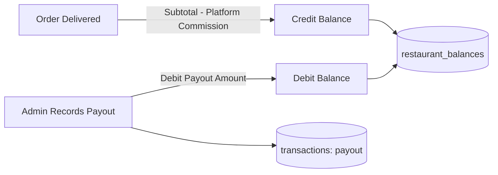

# QuickBite `order-service` — Restaurant Finance Business Logic

## 1. Restaurant Financial Model

Each restaurant maintains a running balance in its operational currency within `restaurant_balances`.



---

## 2. Order Fulfillment Settlement Calculation

When an order status changes to `delivered`:
1. The branch commission percentage (e.g. 15%) is retrieved.
2. Financial computations use exact integer arithmetic in minor units:
   - `subtotal = order.subtotal`
   - `commission = Math.round((subtotal * branchCommission) / 100)`
   - `net_credit = subtotal - commission`
3. Atomic transaction execution:
   ```sql
   -- 1. Insert commission transaction record
   INSERT INTO transactions (region, order_id, method, transaction_type, status, amount, currency, src_acc_id, dst_acc_id)
   VALUES (:region, :orderId, 'internal_balance', 'commission', 'completed', :commission, :currency, :restaurantId, 'quickbite_platform');

   -- 2. Update running balance
   INSERT INTO restaurant_balances (restaurant_id, region, balance, currency, updated_at)
   VALUES (:restaurantId, :region, :netCredit, :currency, NOW())
   ON CONFLICT (restaurant_id) DO UPDATE
   SET balance = restaurant_balances.balance + :netCredit, updated_at = NOW();
   ```

---

## 3. Payout Processing & Recording

Payouts to restaurants are transferred out-of-band via external bank transfer by the finance department. When completed, an administrator records the payout:
1. **Endpoint**: `POST /api/finance/restaurants/:restaurantId/payouts`
2. **Actor**: System Admin only.
3. **Execution Logic**:
   - Acquires pessimistic lock on restaurant balance:
     ```sql
     SELECT balance FROM restaurant_balances WHERE restaurant_id = :restaurantId FOR UPDATE;
     ```
   - Verifies that `payoutAmount <= currentBalance`. (Negative balances are forbidden).
   - Inserts transaction record:
     - `transaction_type = 'payout'`
     - `status = 'completed'`
     - `amount = payoutAmount`
     - `src_acc_id = NULL` *(Null source account indicating QuickBite internal platform issuance)*
     - `dst_acc_id = :restaurantId`
     - `note = 'Bank transfer ref #...'`
   - Decrements restaurant balance:
     ```sql
     UPDATE restaurant_balances SET balance = balance - :payoutAmount, updated_at = NOW() WHERE restaurant_id = :restaurantId;
     ```
   - Commit transaction.
