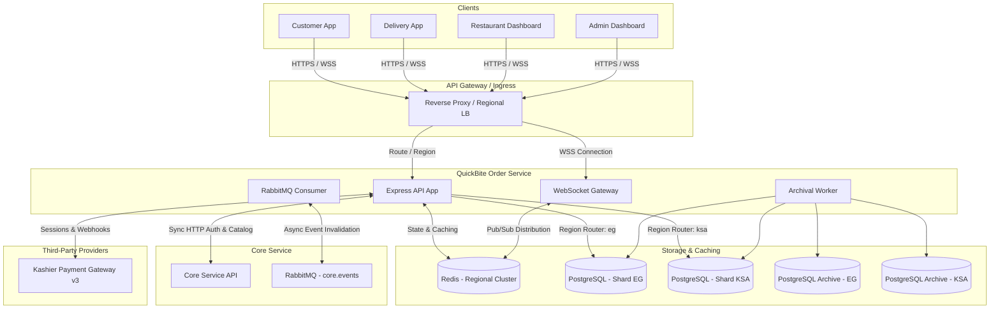

# QuickBite `order-service` — System Design Document

## 1. Architectural Overview & Context

`order-service` is the high-throughput, transactionally critical backend service of the QuickBite platform. It is responsible for order ingestion, lifecycle management, online and COD payments, delivery dispatching and tracking, delivery agent presence, and restaurant financial accounting.

---

## 2. Bounded Context & Service Boundaries

### What `order-service` Owns:
- **Orders**: Placement, order state machine, item snapshots, order tracking, history.
- **Payments**: Kashier v3 payment sessions, webhooks, transaction ledger, refunds, COD collection verification.
- **Deliveries**: Automatic proximity assignment, manual overrides, agent task acceptance/rejection, pickup, delivery completion.
- **Delivery Agents & Presence**: Agent real-time location and presence (Redis hot path + DB durable state), agent delivery history, earnings ledger.
- **Restaurant Finance**: Running restaurant balances, automated commission deductions, admin payout recording, settlement history.
- **Real-Time State**: WebSocket room-based broadcasts to customers, branch staff, agents, and admins.

### What `core-service` Owns (Read-Only logical reference):
- **Users & Identities**: Customers, restaurant owners, branch managers, staff, admins.
- **Restaurants & Branches**: Restaurant profiles, operating hours, active flags, delivery radius, branch geolocation coordinates, commission rates.
- **Products & Menus**: Catalog, pricing, modifier groups, branch stock availability.
- **Customer Delivery Addresses**: Saved address records, geolocation coordinates.
- **RBAC Catalog**: Role definitions and assigned system/restaurant permissions.

---

## 3. Multi-Region Sharding Architecture

QuickBite operates across distinct geographical regions (e.g., `eg` for Egypt, `ksa` for Saudi Arabia).

### Shard Strategy:
- **Shard Key**: `region` / `country_code`.
- **Database Partitioning**: Physical database isolation. Each region runs an independent PostgreSQL cluster (`order_service_eg`, `order_service_ksa`).
- **Zero Cross-Shard Transactions**: Every customer, restaurant, branch, and delivery agent operates within a specific regional context. Joins across regional databases are strictly prohibited.
- **Shard Resolution**:
  1. Explicit query parameter: `?region=eg`
  2. Request Header: `X-Region: eg`
  3. Cookie: `region=eg`
- When a request specifies `region="all"` (restricted to system administrators for global reporting), reads are executed via fan-out queries and aggregated in the application tier.

---

## 4. Caching & Redis Strategy

Redis acts as a sub-millisecond cache and transient state store:
1. **Core Projection Cache**:
   - `core:branch:<id>` (TTL: 1 hour, invalidated on `branch.*` RabbitMQ events)
   - `core:product:<id>` (TTL: 1 hour, invalidated on `product.*` RabbitMQ events)
   - `core:rbac:perms:<role>` (TTL: 24 hours, invalidated on `rbac.*` RabbitMQ events)
2. **Hot Idempotency Cache**:
   - `idempotency:<method>:<path>:<key>` (TTL: 24 hours)
3. **Agent Presence & Geolocation**:
   - `presence:agent:<agentId>` (Hash: `lat`, `lng`, `lastSeenAt`, `status`, TTL: 30 seconds for heartbeat liveness)
   - Geospatial index: `geo:agents:<region>` (`GEOADD`, `GEORADIUS` / `GEOSEARCH` for nearest agent lookups)
4. **WebSocket Fan-Out**:
   - Redis Pub/Sub channels for multi-instance WebSocket broadcasts: `pubsub:ws:<region>`.

---

## 5. Synchronous Service Communication (`core-client`)

When `order-service` needs authoritative verification from `core-service`:
- **Protocol**: HTTP/REST over private virtual network.
- **Authentication**: Mutual pre-shared key header (`X-Internal-API-Key`).
- **Resilience**: Configured timeout (3000ms), 3-tier exponential backoff retry for transient network errors, circuit-breaker awareness.
- **Endpoints Queried**:
  - `GET /internal/branches/:id` — Branch status, coordinates, delivery radius, commission rate.
  - `GET /internal/products/:id/branch/:branchId` — Live price, availability, and stock verification.
  - `POST /internal/products/reserve-stock` — Atomic stock reservation during order checkout.
  - `GET /internal/users/:id` — Customer profile verification.
  - `GET /internal/rbac/roles/:role/permissions` — RBAC permissions set.

---

## 6. Asynchronous Messaging (RabbitMQ Consumer)

Inbound events from `core-service` allow `order-service` to proactively invalidate caches and enforce operational blocks:
- **Exchange**: `core.events` (Topic, Durable)
- **Queue**: `order-service.core-events` (Durable)
- **Dead-Letter Exchange**: `core.events.dlx`, Queue: `order-service.core-events.dlq`
- **Routing Keys & Handlers**:
  - `product.stock.changed`, `product.price.changed` -> Evicts `core:product:<id>`
  - `branch.deactivated`, `branch.updated` -> Evicts `core:branch:<id>` (rejects new incoming orders if deactivated)
  - `restaurant.suspended` -> Evicts `core:restaurant:<id>`
  - `rbac.permissions_changed` -> Evicts `core:rbac:perms:<role>`

---

## 7. Payments Architecture (Kashier v3)

All online payment flows integrate with Kashier v3:
1. **Checkout Initiation**:
   - Customer places order with `payment_method = 'online'`.
   - `order-service` calculates authoritative totals, creates an initial `orders` record in `payment_pending` state, and creates a `transactions` record in `pending` state.
   - `order-service` invokes Kashier v3 Payment Sessions API to generate a checkout URL/token.
2. **Kashier Webhook Handling**:
   - Kashier posts event to `/api/payments/webhook`.
   - Signature verification: Calculates SHA256 HMAC using `KASHIER_API_KEY` and compares against the signature header.
   - Idempotency guard: Durable check on `provider_reference_id` or transaction record. Duplicate webhooks immediately respond `200 OK` without re-processing.
   - Status transition: On `SUCCESS`, transaction transitions to `completed`, order status transitions to `placed`. WebSocket emits `order:created` to restaurant and customer.
   - On `FAILED`, transaction transitions to `failed`, order transitions to `cancelled`.

---

## 8. Real-Time WebSocket Architecture

Order status changes, delivery updates, and driver telemetry are streamed live over WebSockets:
- **Authentication**: Token passed via cookie `access_token` or handshake query `?token=`.
- **Authorized Room Channels**:
  - `customer:<userId>` — Receives updates for personal orders.
  - `restaurant:<restaurantId>` — Receives order placement & status updates.
  - `branch:<branchId>` — Receives branch-specific order notifications.
  - `agent:<agentId>` — Receives delivery dispatch invites and cancellation notices.
- **Security Boundary**: Sockets are automatically assigned to rooms matching their decoded JWT claims. Sockets cannot self-subscribe to arbitrary rooms.

---

## 9. Archival & Retention Strategy

Per the PRD, customer and restaurant operational queries only access the **current calendar year** data on the primary hot PostgreSQL databases.
- Older transactional records (`orders`, `order_items`, `transactions`) are migrated into cold archive databases (`order_service_archive_eg`, `order_service_archive_ksa`) by a scheduled archival worker.
- Retention rules:
  - Hot DB: Retains current year + active pending orders.
  - Cold Archive DB: Retains historical years for audit and tax compliance.
  - Historical reads (e.g., admin tax audit) explicitly target the archive cluster.
