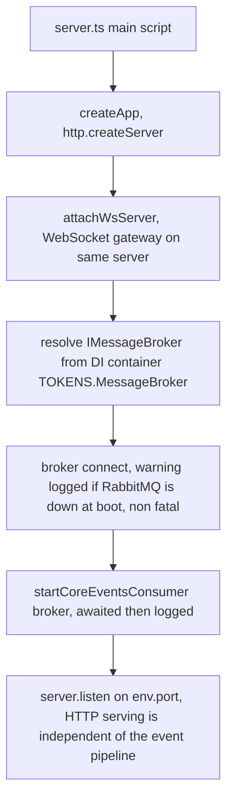
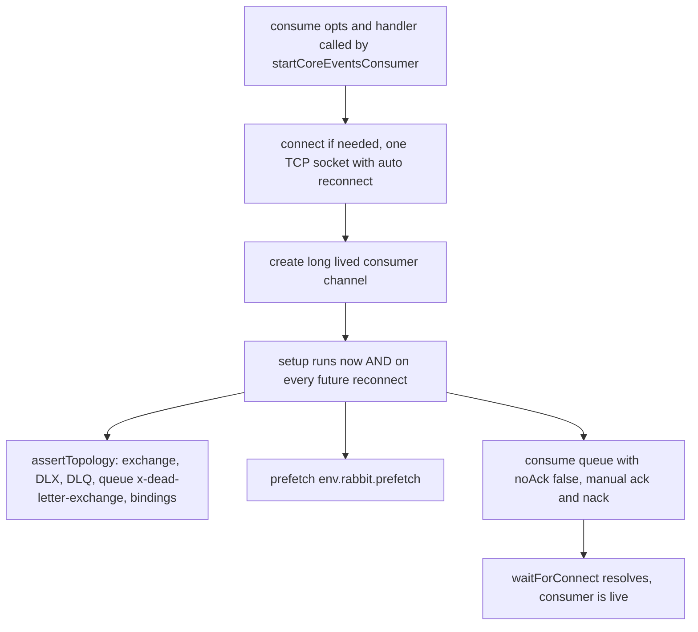
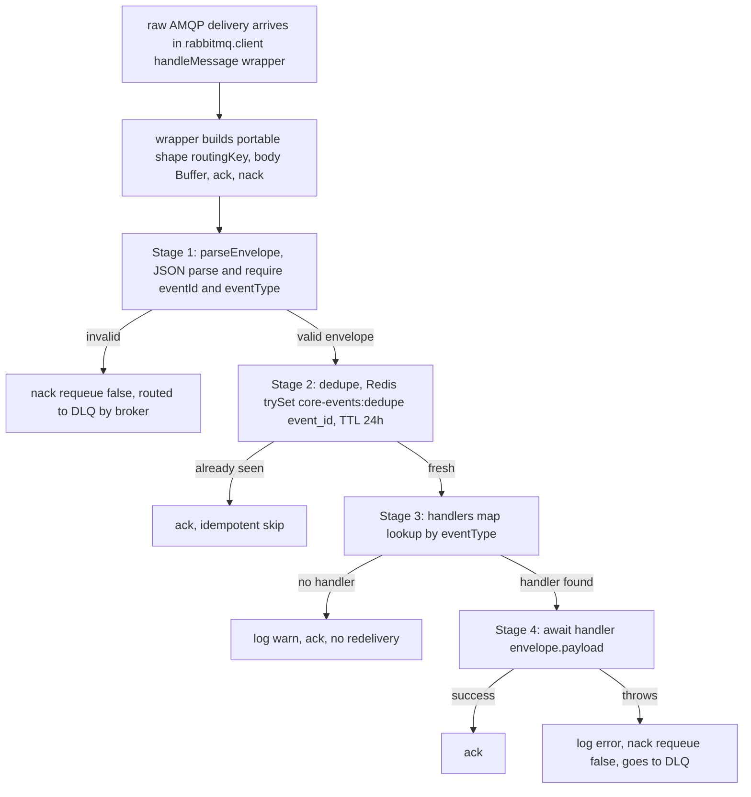
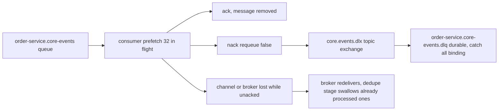
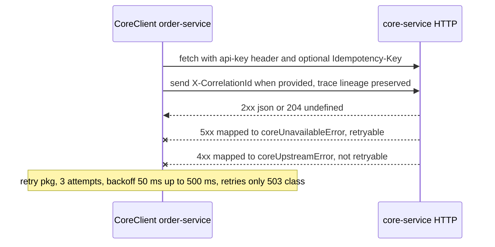
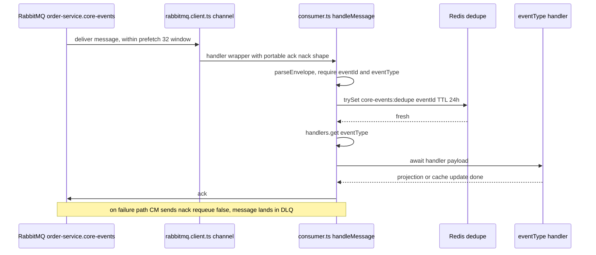

# Event-Driven Architecture — order-service (Consumer Side)

How order-service receives domain events from core-service over RabbitMQ and turns them
into local projection/cache updates, plus the synchronous CoreClient fallback channel.

- Audience: any engineer touching consumers, dedup, DLQ, or the core sync client.
- Publisher-side documentation lives in `core-service/docs/system-design/event-driven-architecture.md`. Cross-link, don't duplicate.
- Related: `system-design.md`, `core-service-integration.md`, `business-logic/orders.md`.

---

## 0. The one-sentence model

order-service subscribes to a durable topic queue bound to `product.# / branch.# /
restaurant.# / rbac.#`, runs every delivery through a four-stage idempotent pipeline
(validate → Redis dedupe → handler dispatch → ack/nack), and falls back to direct HTTP
calls against core-service when real-time correctness beats eventual consistency.

---

## 1. Participants (real files)

| Role | Code |
| --- | --- |
| Bootstrap / consumer start | `src/server.ts` |
| Consumer pipeline + handler registry | `src/lib/core-events/consumer.ts` |
| Envelope + handler types | `src/lib/core-events/types.ts` |
| RabbitMQ client (consume + declareTopology) | `src/pkg/messaging/rabbitmq/rabbitmq.client.ts` |
| Broker interface | `src/pkg/messaging/message-broker.interface.ts` |
| Broker DI registration | `src/lib/di/container.ts` (`TOKENS.MessageBroker`) |
| Env config (queue, DLX, prefetch) | `src/lib/config/env.ts` |
| Redis dedupe (`trySet` = SET NX EX) | `src/pkg/cache/redis.ts:84`, interface `src/pkg/cache/cache.interface.ts:10` |
| Sync fallback HTTP client | `src/lib/core-client/core-client.ts` |
| WebSocket gateway (real-time downstream) | `src/lib/websocket/ws-server.ts` |

## 1.1. Topology identity (from `src/lib/config/env.ts`)

| Item | Value (default) | Env var |
| --- | --- | --- |
| Exchange | `core.events` (topic, durable) | `RABBITMQ_CORE_EVENTS_EXCHANGE` |
| Queue | `order-service.core-events` (durable) | `RABBITMQ_CORE_EVENTS_QUEUE` |
| Bindings | `product.#, branch.#, restaurant.#, rbac.#` | `RABBITMQ_CORE_EVENTS_BINDINGS` |
| Dead-letter exchange | `core.events.dlx` (topic, durable) | `RABBITMQ_CORE_EVENTS_DLX` |
| Dead-letter queue | `order-service.core-events.dlq` (durable, bound with `#`) | `RABBITMQ_CORE_EVENTS_DLQ` |
| Prefetch | `32` | `RABBITMQ_PREFETCH` |

The queue carries `x-dead-letter-exchange: core.events.dlx`, so any `nack(requeue=false)`
or expired message is routed to the DLQ automatically by the broker.

---

## 2. Bootstrap — `src/server.ts`



- The consumer pipeline is **not coupled to HTTP startup**: `broker.connect()` failures at
  boot only log `Core events consumer start warning` and the API keeps serving (`server.ts:22-30`).
- Graceful shutdown (`SIGINT`/`SIGTERM`) closes HTTP, DB (`destroyAll`), Redis
  (`cacheProvider.close`), then the broker connection (`server.ts:39-64`).

---

## 3. Connection management — `src/pkg/messaging/rabbitmq/rabbitmq.client.ts`

One TCP connection, several single-purpose channels. Every channel is a
`ChannelWrapper` whose `setup` runs again on each reconnect, which is what makes the
topology self-healing.

| Channel | Created in | Purpose |
| --- | --- | --- |
| Publisher channel | `connect()` | Long-lived `ConfirmChannel` (publisher confirms on) |
| Topology channel | `declareTopology()` | Throwaway: assert topology, then close |
| Consumer channel | `consume()` | Long-lived: assert topology, `prefetch`, `consume({noAck:false})` |



Because `setup` replays on reconnect, a broker restart or connection loss rebuilds the
asserts, prefetch, and consumer registration with no operator intervention.

`publish()` on the same client supports persistent messages with
`contentType: application/json`. It is the generic direction and exists for future
order-service-to-someone flows; per diagnostic snapshot it has no production call site
yet — Undetermined.

---

## 4. The consumer pipeline — `src/lib/core-events/consumer.ts`

`startCoreEventsConsumer` asserts topology and registers `handleMessage` as the callback.
`handleMessage` is exactly four stages:



Stage details:

**Stage 1 — validation (`parseEnvelope`, `consumer.ts:81`).** JSON parse of
`msg.body.toString("utf8")` into `CoreEventEnvelope { eventId, eventType, occurredAt,
payload }`. Missing `eventId` or `eventType` (or invalid JSON) ⇒ `nack(false)` → DLQ.
A malformed message is a poison pill; requeueing would loop forever, so it goes straight
to the dead-letter queue.

**Stage 2 — dedup (`cacheProvider.trySet`, `consumer.ts:48`).** Redis `SET NX EX`: the key
`core-events:dedupe:{eventId}` is claimed before any processing. `trySet` returning
`false` means this exact `eventId` was already processed ⇒ `ack()` without running
anything. `DEDUPE_TTL_SEC = 24 * 60 * 60` (24h). It covers: worker crash between publish
ack and `markDispatched` on the producer side, redelivery after consumer restart, and
manual DLQ replay. The TTL is declared safe to expire because current handlers are
idempotent cache invalidations (`consumer.ts:7-10`) — if future handlers write DB rows,
those writes must be idempotent too (conditional updates / upserts).

**Stage 3 — dispatch (`handlers` Map, `consumer.ts:12-23`).** Handlers are registered
manually during process boot via `registerHandler(eventType, handler); registering a
duplicate type throws. Unknown event types are acked with a warn — new event types never
block the queue.

**Stage 4 — execution and completion.** `await handler(envelope.payload)`; success ⇒
`ack()`, throw ⇒ logged `core-events: handler failed, sending to DLQ` + `nack(false)` → DLX.

The wrapper in `rabbitmq.client.ts` also catches exceptions escaping `handleMessage`
itself and nacks with `requeue = false` — two safety nets, same DLQ destination.

### Known gap (verified): the handlers map is empty

`registerHandler` has **no call sites** in the current tree. Every valid, fresh event is
therefore processed by nothing: it consumes one Redis SETNX, logs
`core-events: no handler, acking`, and is discarded. Consumer projection work is
not wired yet. Undetermined: whether menu/price cache invalidation currently happens,
if at all, through this channel — verify against the health and cache modules before
trusting event propagation.

---

## 5. Failure and redelivery model



| Failure | Broker behavior | Pipeline behavior |
| --- | --- | --- |
| Invalid envelope | — | `nack(false)` → DLQ |
| Handler throws | — | `nack(false)` → DLQ |
| Consumer crash with unacked messages | Redelivers automatically | Dedupe skips already-done events |
| Broker restart | Channels reconnect, setup reasserts topology, consumer re-registers | Delivery resumes |
| RabbitMQ down at boot | `connect()` keeps retrying | Warning only; HTTP API unaffected |

DLQ consumption/replay: everything routed to `order-service.core-events.dlq` waits for
manual or scripted replay. There is **no automated DLQ replayer or DLQ-depth alert** in
the tree yet — Undetermined.

---

## 6. Envelope contract (consumer view)

```json
{
    "eventId": "a1b2...-uuid",
    "eventType": "product.price.changed",
    "occurredAt": "2026-10-26T10:00:00.000Z",
    "aggregateType": "product_branch_details",
    "aggregateId": "12",
    "payload": { "...": "..." }
}
```

Produced by core-service outbox drain (see the core-service EDA doc, section 5).
Consumer treats `occurredAt` as drain-time metadata, not the business timestamp.
Contract enforcement on this side checks only presence of `eventId` and `eventType`;
per-type payload schemas should be added when handlers are wired.

---

## 7. Synchronous fallback — `src/lib/core-client/core-client.ts`

The event channel is asynchronous and eventually consistent. Data-critical paths
(e.g. checkout-time price and branch validation) use `CoreClient.request()` against
core-service over HTTP instead.



Details verified in code (`core-client.ts:10-39`):

- Auth: `api-key` header = `env.coreService.internalApiKey` (`CORE_INTERNAL_API_KEY`).
- Traceability: `X-CorrelationId` forwarded when the caller supplies it.
- Commit safety: `Idempotency-Key` forwarded when the caller supplies it.
- Retry: `pkg/utils/retry`, 3 attempts, exponential 50→500 ms, retryable only for
  503-class `AppError` or non-AppError transport errors; `>= 500` responses are mapped
  to `coreUnavailableError`, other non-OK to `coreUpstreamError` with body text.

Two-channel rule of thumb:

| Channel | Use for |
| --- | --- |
| CoreClient HTTP | Authoritative real-time checks (checkout, payment gating) |
| RabbitMQ events | Ambient sync of local projections and caches (menus, pools, dashboards) |

---

## 8. End-to-end journey — one delivery



Guarantee summary: transport is at-least-once (producer crash-after-ack, consumer
 crash-before-ack both redeliver); the Redis SETNX stage plus idempotent handlers
collapse that to effectively exactly-once processing within the 24 h dedupe window.
