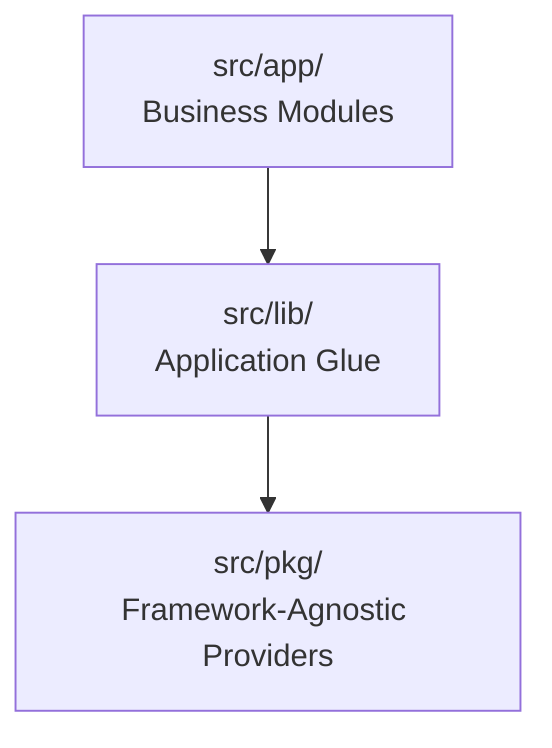

# QuickBite `order-service` — Folder Structure & Architecture Rules

## 1. Directory Tree Overview

```
order-service/
├── .agents/
│   └── skills/                       # Reusable agent procedures & playbooks
│       ├── api-contract-review/SKILL.md
│       ├── database-review/SKILL.md
│       ├── dependency-injection-review/SKILL.md
│       ├── prevent-n-plus-one/SKILL.md
│       ├── response-dto-validation/SKILL.md
│       └── testing-and-debugging/SKILL.md
├── Docs/                             # Architecture, schemas, contracts & business logic
│   ├── business-logic/               # Domain state machines and business rules
│   │   ├── agents.md
│   │   ├── deliveries.md
│   │   ├── orders.md
│   │   ├── payments.md
│   │   ├── rbac.md
│   │   └── restaurant-finance.md
│   ├── System Design/                # Architecture diagrams & illustrations
│   ├── api-contracts.md
│   ├── core-service-integration.md
│   ├── database-design.md
│   ├── folder-structure.md
│   ├── implementation-audit.md
│   ├── implementation-plan.md
│   └── system-design.md
├── src/
│   ├── app.ts                        # Express application factory
│   ├── server.ts                     # Server bootstrap & graceful shutdown lifecycle
│   ├── routes.ts                     # Master router mounting all module routers
│   ├── app/                          # Business/Domain modules (implemented so far)
│   │   └── health/                   # Liveness probe
│   │       └── health.routes.ts
│   ├── lib/                          # Application-aware infrastructure & glue
│   │   ├── auth/                     # Guards, JWT verification, RBAC & API-key middleware
│   │   │                             #   (api-key.ts, errors.ts, guard.ts, jwt.ts, rbac.ts)
│   │   ├── cache/                    # Redis initialization & withCache decorator/middleware
│   │   ├── config/                   # Zod-validated environment configuration (env.ts)
│   │   ├── core-client/              # Resilient HTTP client for core-service
│   │   │                             #   (core-client.ts, errors.ts, types.ts)
│   │   ├── core-events/              # Inbound RabbitMQ consumer for cache invalidations
│   │   │                             #   (consumer.ts, types.ts)
│   │   ├── correlation/              # X-Correlation-ID tracing middleware
│   │   ├── di/                       # TSyringe DI container and injection tokens
│   │   ├── error/                    # AppError class and Express error handler
│   │   ├── http/                     # Response formatters (response.ts)
│   │   │   └── pagination/           # cursor-pagination.ts, parse-query.ts
│   │   ├── idempotency/              # Dual-layer Redis/DB idempotency middleware
│   │   ├── knex/                     # Sharded Knex connection manager (knex.ts, knexfile.ts, shards.ts)
│   │   ├── logger/                   # Structured JSON logger
│   │   ├── messaging/                # RabbitMQ lifecycle and DI binding (init.ts)
│   │   ├── sharding/                 # Region resolver & shard router
│   │   │                             #   (errors.ts, region-resolver.ts, regions.ts)
│   │   ├── types/                    # Ambient express typings (express.d.ts)
│   │   ├── validation/               # class-validator runner (validate.ts, validation.error.ts)
│   │   └── websocket/                # WebSocket gateway and room broadcast hub
│   │                                 #   (errors.ts, ws-auth.ts, ws-server.ts)
│   ├── pkg/                          # Pure, framework-agnostic utilities & providers
│   │   ├── cache/                    # Redis cache provider interface & implementation
│   │   │                             #   (cache.interface.ts, redis.ts)
│   │   ├── messaging/                # amqplib RabbitMQ client abstraction
│   │   │   └── rabbitmq/             #   (message-broker.interface.ts, rabbitmq.client.ts, rabbitmq.types.ts)
│   │   ├── payments/                 # Kashier v3 client & signature verifier (kashier.ts)
│   │   └── utils/                    # Pure helpers: money, time, retry
│   └── migrations/                   # PostgreSQL migrations per region
│       ├── 20261006120000_create_orders_tables.ts
│       ├── 20261006121000_create_payment_tables.ts
│       ├── 20261006122000_create_deliveries_and_agents_tables.ts
│       └── 20261006123000_create_restaurant_finance_tables.ts
├── dist/                             # Compiled JS output (build artifact, gitignored)
├── .env.example
├── .gitignore
├── AGENTS.md                         # Permanent project rules & invariants
├── README.md                         # Engineering constraints and conventions
├── package.json
└── tsconfig.json
```

---

## 2. Layering Boundaries & Import Rules



1. **`src/pkg/`** — MUST NOT import from `src/lib` or `src/app`; MUST NOT read `process.env`; no Express/Knex concepts.
2. **`src/lib/`** — May import `src/pkg/` + config; MUST NOT import domain entities/DTOs/controllers from `src/app/` (sole exception: `src/lib/di/container.ts` wiring injectables at startup).
3. **`src/app/`** — May import `src/lib/` and `src/pkg/`; a module MUST NOT import another module's repository directly — cross-module reads go through services like domain events.
